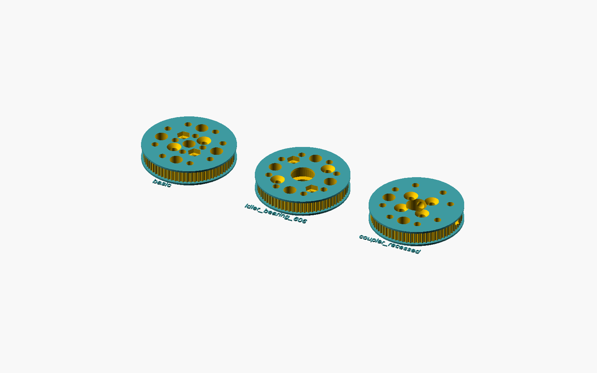
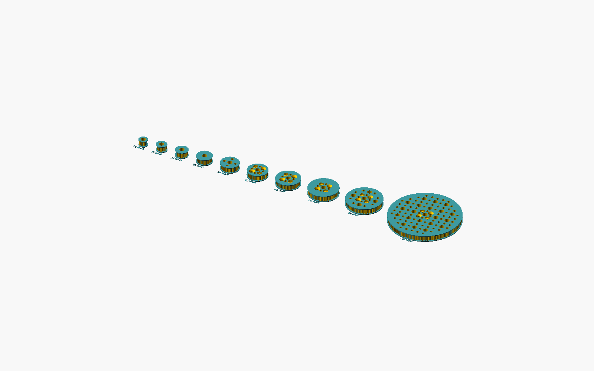

# OOBB timing pulleys

GT2 timing pulleys for OOBB. Browse the generated [navigation_oobb files](navigation_oobb/) or [all 30 options](catalogue.md). Each option includes printable STL and editable SCAD files. For example: [72-tooth basic pulley](navigation_oobb/oobb_name_timing_pulley/number_of_teeth_72/style_basic/depth_6/oobb_part_timing_pulley_3_diameter_72_number_of_teeth_basic_6_depth/).





This project makes heavy use of AI: the parts and code are AI generated, and the code is intended to be changed with AI rather than edited by hand. To add a feature, run the project on your own computer and ask an AI coding assistant to make the changes. Check fit and dimensions before printing.

Run `setup_and_run.bat` once. Then:

```bat
call .venv\Scripts\activate.bat
python make_all.py
```
