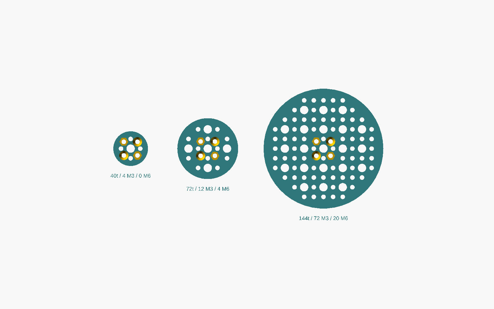

# OOBB timing pulleys, version 5

30 populated GT2 pulley options, using the `working_populate` → `working_oomp`
→ `working_scad` pipeline and a shared `oobb_timing_pulley` primitive installed
in OOBB v5. Each generated part has source YAML, enriched OOMP YAML, a portable
print SCAD, an assembled SCAD, and a printable binary STL.


## Catalogue and taxonomy

All ten tooth counts from version 4 are included: **16, 20, 24, 30, 36, 40, 48,
60, 72, 144**, each for **6 mm and 9 mm belts**. The first styles are:

| Style | Tooth counts | Options | Construction |
| --- | --- | ---: | --- |
| `basic` | all ten | 20 | One piece below 40 teeth; clamshell from 40 teeth |
| `idler_bearing_606` | 60, 72, 144 | 6 | Captured 606 bearing, two halves |
| `mechanical_coupling_recessed`, 5 mm shaft bore | 72, 144 | 4 | Barrel through central hole; four screws join the halves and flange |

Only the **5 mm shaft-bore coupler** is populated. It has a 22 mm flange,
10 mm barrel diameter, 12 mm overall height, and four M3 clearance holes on a
16 mm bolt circle. The full measured CSV remains a source reference; it does
not generate the other bore sizes. Superseded generated couplers are removed
from `parts` and `parts_source` and kept in ignored `temporary/retired_couplers`
storage. The basic and 606 idler ranges remain available.

The verbose taxonomy is:

```text
oobb / part / timing_pulley / {diameter}_diameter /
{number_of_teeth}_number_of_teeth / {style} / {depth}_depth /
{coupler_bore}_mm_bore   # coupling styles only
```

For example:

```text
oobb_part_timing_pulley_3_diameter_72_number_of_teeth_mechanical_coupling_recessed_6_depth_5_mm_bore
```

`diameter` is the legacy OOBB grid-size calculation, clamped to at least one;
the actual pitch diameter is `number_of_teeth * 2 / pi`. `depth` means nominal
belt width. Every style uses 0.5 mm belt clearance plus a 1 mm flange on each
side: a 6 mm belt gets a 6.5 mm channel and an 8.5 mm printed pulley body; a
9 mm belt gets a 9.5 mm channel and an 11.5 mm body. Coupler dimensions do not
increase the pulley body thickness. Belt width and assembled body depth are
recorded separately in every option.


See [the complete file index](catalogue.md).

## Where definitions live

`working_populate.py` builds explicit `option` dictionaries containing sizes,
style, hardware dimensions, and fit settings. Its final loop projects those
details into the taxonomy and `oobb_details`. Geometry never parses the ID.

`working_oomp.py` reads `parts_source/*/working.yaml` and calls OOMP v5's
`add_part` to write the enriched `parts/*/working.yaml`. `working_scad.py` reads
those files and dispatches `oobb_timing_pulley` through OOBB. The conventional
`working_oomp_populate.py` entry point delegates to `working_populate`.

The version 4 size source was
`C:/gh/oomlout_oobb_version_4/oobb_make_sets.py:get_pulleys`, with geometry in
`oobb_get_items_oobb.py:get_pulley_gt2`. This first catalogue uses the requested
basic, 606, and coupling styles across those tooth counts and belt widths.

## Shared OOBB changes

Reviewed installable copies are kept under `source_file/oobb_components`:

- `oobb_timing_pulley/working.py`: shared composite primitive and dimensions API.
- `pulley_gt2/working.py`: validated tooth count/depth and per-instance fit settings.
- `pulley_gt2.scad`: inherited GT2 polygon with explicit width/depth allowances,
  a solid core, and a renamed obsolete `40DP` module for current OpenSCAD syntax.

`source_file/oobb_variable_additions.yaml` supplies the missing M4 countersunk
head variables. The installer adds absent definitions without replacing
existing local values. It copies only the listed component files and SCAD asset.
These changes are also installed in the active `C:/gh/oomlout_oobb_version_5`.

## Assembly and printing

The basic and idler clamshells use four M3 `screw_countersunk` cutouts with `nut=True`
and `overhang=True`. Alternating screws enter opposite faces. Both halves have
their mating faces on the bed; the lower half is flipped about X. Tooth phases
match when the lower half is flipped back. The default gap between print parts
is 10 mm. There is no axial gap in the assembled teeth.

The 606 pocket has 0.15 mm radial and 0.2 mm total axial allowance. A 12 mm relief
opening leaves lips against the outer race, clearing the inner race and axle.
The bearing is inserted before closing the halves.

The coupling version uses the same belt channel and flange thickness as the
basic pulley. Its **10.4 mm through hole clears the metal coupler's 10 mm
barrel**; the actual shaft runs in the coupler's 5 mm bore. The metal is allowed
to extend beyond the normal pulley faces.

The coupler flange top sits directly against the lower pulley face, with no
lift, spacer rings, or flange seat. The user-specified grub screw is halfway
along the 10 mm barrel, **5 mm above the flange top face**. The split and both
round Allen-key holes follow that axis, slightly off the belt centre:

| Belt width | Flange top Z | Split / grub axis Z | Lower half | Upper half |
| ---: | ---: | ---: | ---: | ---: |
| 6 mm | -4.25 mm | +0.75 mm | 5 mm | 3.5 mm |
| 9 mm | -5.75 mm | -0.75 mm | 5 mm | 6.5 mm |

The origin remains at the belt centre. The unequal halves retain the original
belt channel and overall body thickness. Both mating faces are translated to
Z=0 in the print layout after the lower half is flipped.

**The same four M3 screws join both pulley halves and the metal flange.** There
is no additional outer ring of joining screws on the coupling version. The
flange pattern is rotated 45 degrees, leaving the orthogonal Allen-key paths
clear. The screw heads enter the upper pulley face; loose nuts sit underneath
the metal flange. Countersunk and nut clearances still use OOBB primitives with
`nut=True` and `overhang=True`.

Two **round 4 mm radial Allen-key holes** are centred on the offset mating
plane. Each printed half contains its matching semicircle. Material remains
above and below the holes. Cutaway layouts and `assembly_with_coupler.scad`
show the metal seated directly against the pulley. Production pulley STLs
contain just the two printed halves; the purchased metal and loose fasteners
are separate. Regeneration removes obsolete spacer exports.

The 16-tooth basic option has a 0.6 mm minimum web setting around its 6.5 mm bore.
The 40-tooth clamshell uses 0.45 mm around the enlarged OOBB M3 print head
envelopes. Other options require at least 1 mm. These settings are explicit in
the options. Smaller hardware-bearing combinations are rejected before drawing.

Select screw length from the recorded assembled dimensions and the actual
hardware. Clearances are initial print values; the supplied fit trials allow
checking the printer, bearing, coupler, and actual Allen key before a full build.
Physical assembly and belt-load testing have not been performed.

## OOBB mounting holes

Every option enables the available centred OOBB pattern: **M6 on the 15 mm
grid**, and **M3 on intervening 7.5 mm positions**. Both coordinates must be
multiples of 15 mm for an M6 position. The existing central shaft/bearing opening
owns the origin; no duplicate centre hole is added. Named `oobb_hole` primitives
supply the correct clearances in each export mode.

The grid stays fixed relative to the pulley. `joining_rotation=45` explicitly
places the four joining fasteners on the diagonal axes. Hole selection checks
the full print-size screw head and nut envelopes rather than only the shaft
holes, and leaves at least `oobb_hole_minimum_web=0.3` mm between mounting holes
and the tooth roots, centre features, or joining/coupler hardware. Holes also
clear the real coupler flange and the radial Allen-key access windows.

Small pulleys and tightly packed centre styles can have no additional mounting
holes. The pattern fills every safe grid position; excluded positions and their
physical reason are recorded alongside `oobb_hole_positions` in each option's
assembled dimensions. Counts are per assembled pulley, not per printed half.

| Basic pulley teeth | Additional M3 holes | Additional M6 holes |
| ---: | ---: | ---: |
| 16, 20, 24, 30 | 0 | 0 |
| 36, 40, 48, 60 | 4 | 0 |
| 72 | 12 | 4 |
| 144 | 72 | 20 |



## Regenerate

Python must be able to import the local OOBB v5 and OOMP v5 repositories. Install
the Python requirements and have OpenSCAD on PATH. On this machine both are
already configured.

```powershell
python install_oobb_components.py
python working.py
python validate_catalogue.py --jobs 4
python action_test_layouts.py --render --stl
python action_documentation.py
python -m pytest -q
```

To generate a focused part, keeping the same population and enrichment stages:

```powershell
python working.py --filter 72_number_of_teeth_basic_6_depth --generate-stl
python working.py --filter 72_number_of_teeth_mechanical_coupling_recessed_6_depth_5_mm_bore --layout section
```

The latter command writes section views to that part's SCAD files; run the
default build again to restore print and assembly layouts. `true.scad` defaults
to assembly, and `3dpr.scad` to the print layout. Every SCAD folder contains its
own `pulley_gt2.scad`, so exported geometry does not depend on a machine path.

## Tests and review layouts

`tests/test_timing_pulleys.py` checks taxonomy uniqueness, complete legacy size
coverage, rejection of impossible combinations, OOMP round trips, printable
halves, retained bearing faces, coupler pockets and mount holes, Allen-key
windows, transforms, real GT2 tooth counts/diameters, and geometric effects of
fit allowances. OpenSCAD mesh checks fail on warnings and inspect watertightness,
connected parts, bed placement, and material at functional locations.
The grid checks cover every catalogue option, ensure that both hole sizes stay
on their correct lattice, check the diagonal joining pattern and hardware
separation, and inspect the actual through-hole radii in true and print modes.

`validate_catalogue.py` exports and inspects **every** populated print layout,
writing [the machine-readable report](examples/catalogue_validation.json).
An additional mesh-intersection test confirms that the measured metal reference
fits inside the pulley cavity without intersecting the printed body.
It also checks that every declared grid hole is open at both flange faces and
through the interior of both print halves, accounting for the lower half's flip
and each half's actual thickness. Mesh checks also verify flush flange contact,
the offset split and access holes, and bed placement of the unequal halves.

| Layout | Purpose |
| --- | --- |
| [All tooth counts](examples/all_tooth_counts/working.png) | Compare the full legacy diameter range |
| [OOBB hole pattern](examples/oobb_hole_pattern/working.png) | Top view of M3/M6 through holes and the 45-degree joining fasteners |
| [Style comparison](examples/style_comparison/working.png) | Basic, 606 idler, and recessed 5 mm coupler at 72 teeth |
| [Print pairs](examples/clamshell_print_pairs/working.png) | See each half and its bed orientation |
| [Bearing fit](examples/bearing_fit/working.png) | 0.05 / 0.15 / 0.25 mm radial allowance trials |
| [Coupler sections](examples/coupler_sections/working.png) | 72/144 tooth exploded and cutaway views with the recessed 5 mm metal coupler |
| [Coupler seam alignment](examples/coupler_seam_alignment/working.png) | Compare 6/9 mm belt bodies, flush flange contact, and the offset split/tool axis |
| [Coupler fit](examples/coupler_fit/working.png) | 0.1 / 0.2 / 0.3 mm radial allowance trials |

Each layout includes its reproducible SCAD and a YAML manifest. Print pairs,
bearing trials, and coupler trials also include STL files. Raised labels are
separate geometry on these review plates; production part STLs contain the
pulley halves alone.
